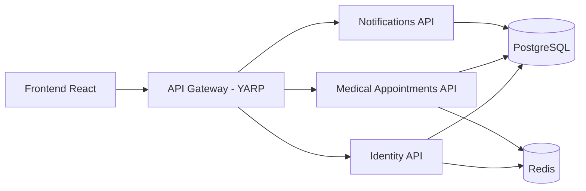

# Arquitectura del sistema

Este documento describe la arquitectura **implementada hoy**. Lo que aún es solo una intención de diseño está agrupado en [Planificado (no implementado)](#planificado-no-implementado). Estado detallado y limitaciones: [SUMMARY.md](../SUMMARY.md).

## Visión general

Hub de Servicios Ciudadanos es un conjunto de microservicios .NET 8 detrás de un API Gateway, con un frontend React. Cada servicio sigue Clean Architecture y CQRS (MediatR) y tiene su propia base de datos PostgreSQL.



Cada servicio usa su propia base de datos (`identity_db`, `medical_appointments_db`, `notifications_db`) y su propio rol de PostgreSQL con permisos solo sobre esa base. Redis se usa como caché distribuida en Identity y Medical Appointments (por ejemplo, para códigos de verificación).

## Componentes

| Componente | Ubicación | Responsabilidad | Estado |
|---|---|---|---|
| API Gateway | `src/ApiGateway` | Enrutamiento (YARP), rate limiting por IP, CORS. Registra la validación de JWT, pero no exige autenticación en ninguna ruta: cada servicio valida el token | Implementado; destinos en `localhost` salvo en Docker Compose, que usa los nombres de servicio |
| Identity | `src/Services/Identity` | Registro, login, emisión de JWT, usuarios y roles | Parcial |
| Medical Appointments | `src/Services/MedicalAppointments` | Turnos médicos y centros de salud | Parcial |
| Notifications | `src/Services/Notifications` | Notificaciones por usuario y despacho por canal | Parcial; senders externos son stubs |
| Frontend | `src/WebApp` | Interfaz de usuario | Parcial |
| BuildingBlocks | `src/BuildingBlocks` | Código compartido: `Common`, `EventBus`, `Logging`, `Security` | Implementado |

### Estructura de un servicio

```
Servicio/
├── Servicio.Domain/          # Entidades, value objects, eventos de dominio, interfaces de repositorio
├── Servicio.Application/     # Comandos y queries (MediatR), DTOs, validadores, reglas de acceso
├── Servicio.Infrastructure/  # EF Core, repositorios, integraciones externas
├── Servicio.API/             # Controladores, middleware y composición
└── Servicio.Tests/           # Pruebas xUnit
```

Dependencias: `API → Application → Domain` e `Infrastructure → Application/Domain`. La lógica de negocio y las reglas de acceso viven en la capa Application; los controladores solo traducen resultados a HTTP.

### BuildingBlocks

| Proyecto | Contenido |
|---|---|
| `Common` | `Result`/`Error`, abstracciones CQRS, entidades base, `ICurrentUserService` |
| `Logging` | Configuración de Serilog y logging de peticiones |
| `Security` | `AddCityServicesJwtAuthentication`, `AddCityServicesCors`, `HttpContextCurrentUserService` (con `Security.Tests`) |
| `EventBus` | Abstracciones de bus de eventos y manejador de suscripciones (sin uso activo) |

`src/Shared/` contiene tipos equivalentes a los de `BuildingBlocks`, no forma parte de la solución y está pendiente de consolidarse.

## Seguridad

### Implementado

- **Autenticación:** JWT Bearer firmado con HS256. Un solo contrato de configuración (`JwtSettings:SecretKey`, `Issuer`, `Audience`) para Identity, Medical Appointments, Notifications y el gateway. Se validan firma, emisor, audiencia y expiración; solo se acepta HS256; la clave debe tener al menos 32 bytes y el servicio no arranca si falta.
- **Contraseñas:** BCrypt (costo 12). La cuenta se bloquea 15 minutos tras 5 intentos fallidos.
- **Autorización:** los endpoints de turnos y notificaciones exigen token. En Medical Appointments, un turno solo es accesible para su paciente titular o `Administrator`/`SuperAdmin`; la identidad se toma del token y los turnos ajenos responden `404`. Identity restringe `GET /auth/{id}` a administradores.
- **CORS:** lista explícita de orígenes (`Cors:AllowedOrigins`); el comodín `*` se rechaza al iniciar.
- **Secretos:** fuera del repositorio. Se inyectan por variables de entorno (`.env`, ignorado por git; plantilla en `.env.example`); `docker-compose.yml` falla si falta alguna.
- **Base de datos:** un rol de PostgreSQL por servicio, dueño únicamente de su base; los servicios no usan la cuenta administradora.
- **Rate limiting:** en el gateway (por IP), con un límite más estricto para `/auth/login`.

### Limitaciones de seguridad conocidas

2FA no está implementado (el login con 2FA habilitado se rechaza), el frontend guarda tokens en `localStorage`, el rate limiting confía en `X-Real-IP` del cliente y hay dependencias con avisos de seguridad. Detalle y prioridad en [SUMMARY.md](../SUMMARY.md).

## Comunicación

- **Síncrona:** HTTP/REST entre el frontend y el gateway, y del gateway a los servicios.
- **Asíncrona:** no operativa. Existe una implementación `RedisEventBus` (publicación por canales de Redis) y los agregados generan eventos de dominio, pero el bus no está registrado en la inyección de dependencias y ningún flujo activo publica ni consume eventos.

## Despliegue

`docker-compose.yml` define PostgreSQL, Redis, RabbitMQ, el gateway, Identity, Medical Appointments y el frontend (Nginx). RabbitMQ no tiene uso en el código. Notifications no está incluido. No hay entornos de staging ni producción definidos. CI en `.github/workflows/ci.yml`: compilación y pruebas del backend, lint y build del frontend, y build de imágenes Docker en push a `main`.

## Decisiones pendientes

Estas decisiones no están tomadas y no hay ADR que las registre: bus de eventos (Redis o RabbitMQ), esquema de firma de JWT (clave simétrica compartida o RS256 con clave pública), y estrategia de refresco de tokens.

## Planificado (no implementado)

Lo siguiente aparece en el diseño original, pero no existe código:

- Servicios Legislative, HR, Tax Management, Document Management y Citizen Portal.
- Saga para flujos distribuidos, Circuit Breaker, event sourcing.
- OAuth 2.0 / OpenID Connect, políticas de autorización por atributos, MFA operativo.
- Observabilidad: métricas, trazas distribuidas, correlación de peticiones.
- Réplicas, alta disponibilidad, backups y recuperación ante desastres.
